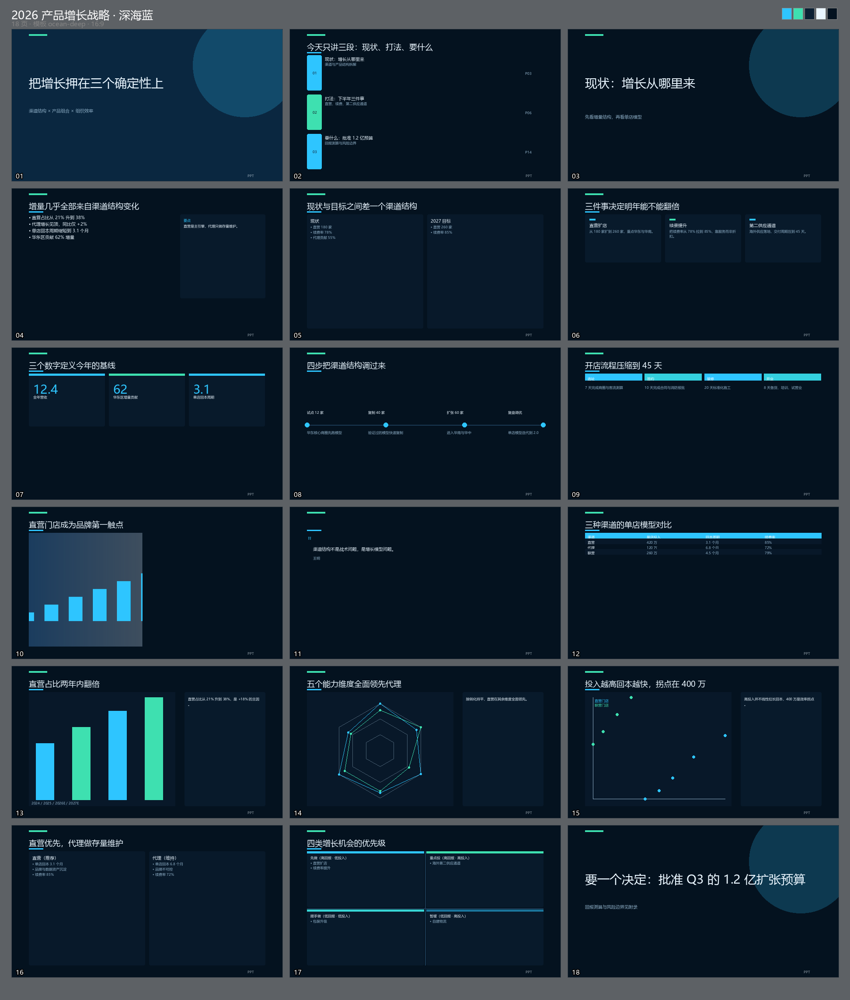

# dsh-ppt-master · DSH「PPT 大师」模式

[](https://github.com/weijianguizhou/dsh-ppt-master/actions/workflows/ci.yml)
[](LICENSE)
[](package.json)
[](https://python-pptx.readthedocs.io/)

> 让 DSH 里的 Agent 变成一位演示顾问：**联网取材 → 立纲 → 选/建模板 → 一键生成真 PPTX → 设计审校 → 迭代**。
> 输出是 python-pptx 真实渲染的原生对象（文字框、图表、表格都能在 PowerPoint 里继续编辑），不是图片拼贴。



---

## 一、这是什么

给 [DSH（DeepSeek Harness）](https://github.com/) 装一个「**PPT 大师**」会话模式与配套工具：

| 装完之后你得到 | 说明 |
| --- | --- |
| 一个会话模式 | 新建会话时选「PPT 大师」，常驻大师人设 + 五步工作流 + 实时模板清单 |
| 五个工具 | `ppt_research` / `ppt_templates` / `ppt_build` / `ppt_lint` / `ppt_doctor` |
| 一个技能 | `ppt-master` 方法论手册（版式选择表、设计硬规则、反面清单、排障） |
| 八套模板 | 靛蓝商务、极简素白、深空科技、暖阳人文、青瓷东方、数据亮色、石墨黑白、深海蓝 |
| 十六种版式 | 覆盖封面、议程、KPI、图表、表格、时间线、2×2 矩阵、对比、金句、全出血大图等 |
| 八类原生图表 | 柱状、条形、折线、面积、饼、环、堆叠、**雷达**、**散点** |
| 质量闸门 | 设计审校器（结论式标题/要点上限/数字进图表/讲稿齐备…）+ 渲染后结构自检 |

## 二、安装

**前置条件**

- 已安装 DSH，且版本支持宿主插件与 bundle（`dsh plugin` 命令可用）。
- Node.js **≥ 20**（插件与工具走宿主 Node 运行）。
- Python **≥ 3.10**，并安装 `python-pptx>=1.0` 与 `pillow>=10`：

```bash
python -m pip install "python-pptx>=1.0" "pillow>=10"
```

> DSH 桌面版自带 Python 运行时，插件会自动探测；也可以设置 `DSH_PPT_PYTHON`
> 指向任意可用的解释器。

**安装插件**

```bash
# 从本地目录安装（推荐：源码目录即唯一真源）
dsh plugin add file:/absolute/path/to/dsh-ppt-master

# 发布到 npm 之后也可以直接
dsh plugin add dsh-ppt-master
```

安装后**重启一次 DSH**，新建会话时在模式选择器里选「**PPT 大师**」。

**自检**

```text
ppt_doctor        # Python / python-pptx / Pillow / 字体 / 模板目录 / 各服务
```

模板画廊与健康检查（把 `<DSH_WEB_ADDR>` 换成你自己的 DSH Web 地址，如 `http://127.0.0.1:52707`）：

```text
<DSH_WEB_ADDR>/plugins/dsh-ppt-master/gallery      # 8 套模板配色/气质一屏看完
<DSH_WEB_ADDR>/plugins/dsh-ppt-master/templates    # 模板 JSON
<DSH_WEB_ADDR>/plugins/dsh-ppt-master/status       # 健康检查
```

## 三、五个工具

| 工具 | 作用 | 关键点 |
| --- | --- | --- |
| `ppt_research` | 联网取材 | `kind` = facts / images / palette / inspiration；`images` 会抓页面 `og:image`，返回可直接填进 deck 的图片 URL；无搜索密钥时可用 `urls` 直抓 |
| `ppt_templates` | 模板库 | `list / get / save / delete`；`save` 支持 `baseOn` 派生，只覆盖想改的字段 |
| `ppt_build` | **核心：生成 PPTX** | 内联 deck JSON 或 `deckPath`；同时输出全页预览 PNG；自动下载图片、cover 裁切、字号回落防溢出、生成后结构自检 |
| `ppt_lint` | 设计审校 | 给出 `score` 与「问题 → 改法」清单（必改 / 建议 / 可选） |
| `ppt_doctor` | 环境自检 | Python / python-pptx / Pillow / 字体 / 模板目录写权限 / 各服务可用性 |

## 四、怎么用

### 4.1 说人话

> 用 PPT 大师模式，帮我把这份季度复盘做成 12 页的汇报，先给提纲。

Agent 会按手册执行：**定受众/场合/决策目标 → 取材 → 立纲（标题句）→ 选模板 → 先出 3-5 页小样 → 补全 → 审校 → 交付**。

### 4.2 直接指挥工具

```text
ppt_templates  action=list
ppt_research   query="2026 新能源汽车渗透率"  kind=facts
ppt_build      template="ocean-deep"  deck={...}  out="D:\\报告\\q3.pptx"
ppt_lint       deck={...}
ppt_doctor     {}
```

### 4.3 deck 速查

```jsonc
{
  "title": "2026 增长战略", "subtitle": "董事会汇报", "author": "战略部", "date": "2026-10",
  "template": "indigo-corporate",
  "slides": [
    { "layout": "cover", "kicker": "战略规划", "title": "把增长押在三个确定性上",
      "subtitle": "渠道结构 × 产品组合 × 组织效率", "image": "https://…jpg", "notes": "开场 30 秒" },

    { "layout": "agenda", "title": "今天只讲三段",
      "agenda": [
        { "title": "现状",  "desc": "渠道与产品结构", "page": "P03" },
        { "title": "打法",  "desc": "下半年三件事",   "page": "P06" },
        { "title": "要什么", "desc": "回报与风险",     "page": "P14" }
      ] },

    { "layout": "kpi", "title": "三个数字定义今年的基线",
      "kpi": [{ "value": "12.4", "unit": "亿元", "label": "全年营收", "delta": "+18%", "hint": "口径：合并报表" }] },

    { "layout": "chart", "title": "增量几乎全部来自渠道结构变化", "insight": "直营占比 21%→38%，是主因",
      "chart": { "type": "bar", "categories": ["Q1", "Q2", "Q3", "Q4"],
                 "series": [{ "name": "直营", "values": [1.2, 1.9, 2.6, 3.4] }] } },

    { "layout": "chart", "title": "五个维度的能力对比", "insight": "短板在复购",
      "chart": { "type": "radar",
                 "categories": ["获客", "转化", "复购", "服务", "品牌"],
                 "series": [{ "name": "直营", "values": [9, 8, 5, 8, 9] },
                            { "name": "代理", "values": [6, 7, 6, 6, 5] }] } },

    { "layout": "chart", "title": "门店投入与回报的关系", "insight": "直营店回报更高",
      "chart": { "type": "scatter",
                 "series": [{ "name": "直营门店", "points": [{ "x": 420, "y": 3.1 }, { "x": 460, "y": 3.4 }] },
                            { "name": "联营门店", "points": [[230, 4.2], [260, 4.5]] }] } },

    { "layout": "matrix", "title": "四类增长机会的优先级", "insight": "预算优先给左上象限",
      "matrix": { "xAxis": "投入", "yAxis": "回报",
        "quadrants": [
          { "title": "先做（高回报·低投入）", "items": ["直营扩店", "续费率提升"] },
          { "title": "重点投", "items": ["海外第二供应通道"] },
          { "title": "顺手做", "items": ["包装升级"] },
          { "title": "暂缓", "items": ["自建物流"] }
        ] } },

    { "layout": "bullets", "title": "下半年只做三件事", "insight": "资源聚焦在回报最高的两件事上",
      "bullets": [{ "text": "直营门店从 180 家扩到 260 家", "level": 0 },
                  { "text": "把续费率从 78% 提到 85%", "level": 0 }] },

    { "layout": "end", "title": "要一个决定：批准 Q3 的 1.2 亿扩张预算", "contact": "战略部 · 王明" }
  ]
}
```

字段约定：

- `notes`：讲稿，写进 PPT 备注（每页 2-4 句）。
- `insight`：这一页的结论句（图表/要点页必填，观众不用自己猜）。
- `image`：本地路径或 `http(s)` URL（自动下载 + cover 裁切，不拉伸）。
- `agenda`：3-6 条；`{title, desc, page}`，纯字符串数组也可以。
- `matrix`：必须 4 个象限，顺序为**左上、右上、左下、右下**；`xAxis` / `yAxis` 可选。
- `chart.type`：`bar`｜`column`｜`bar-h`｜`line`｜`area`｜`pie`｜`doughnut`｜`stacked`｜`radar`｜`scatter`。
  - 分类类图表：`categories` 与每个 series 的 `values` 数量必须一致；
  - `scatter`：不要 `categories`，用 `series[].points`（`[{x,y}]` 或 `[[x,y]]`，每个系列 ≥ 2 个点），散点不支持数据标签。

### 4.4 模板与自建

| 模板 id | 气质 | 适合 |
| --- | --- | --- |
| `indigo-corporate` | 靛蓝商务 | 汇报、融资、董事会 |
| `minimal-paper` | 极简素白 | 学术、评审、白皮书 |
| `deepspace-tech` | 深空科技 | 技术发布、产品架构 |
| `warm-sunrise` | 暖阳人文 | 品牌、文化、内部沟通 |
| `celadon-cn` | 青瓷东方 | 东方美学、政府/文化项目 |
| `data-vivid` | 数据亮色 | 数据看板式汇报 |
| `graphite-mono` | 石墨黑白 | 正式打印、省墨、黑白复印友好 |
| `ocean-deep` | 深海蓝 | 深色科技感、发布会 |

自建模板（`baseOn` 派生，只覆盖想改的字段）：

```text
ppt_templates action=save baseOn="minimal-paper" name="年度总结·墨绿" id="annual-ink"
  theme={"primary":"#2F6B5E","accent":"#C25E3A","bg":"#FBFAF7"}
  geometry={"marginX":1.0,"bodySize":16,"lineSpacing":1.4}
  decor={"style":"soft","coverPattern":"rule"}
```

单位：`geometry` 全部英寸、字号磅（pt）、颜色 `#RRGGBB`。
`decor.style` ∈ `glow | grid | soft | ink | none`；`decor.coverPattern` ∈ `orbs | grid | rule | arc | seal | bars`。
用户模板存在 `<DSH_HOME>/ppt-master/templates/*.json`，同 id 覆盖内置模板。

### 4.5 十六种版式

| layout | 用途 | 关键字段 |
| --- | --- | --- |
| `cover` | 封面 | title, subtitle, kicker, image, author, date |
| `section` | 章节转场 | index, title, subtitle |
| `agenda` | 议程/目录 | title, agenda[{title,desc,page}] |
| `bullets` | 要点页 | title, bullets[], insight |
| `two-col` | 左右两栏 | title, columns[{title,bullets[]}] |
| `cards` | 卡片并列 | title, cards[{title,body,icon,color}] |
| `kpi` | 大数字 | title, kpi[{value,unit,label,delta,hint}] |
| `timeline` | 时间线 | title, steps[{time,title,desc}] |
| `process` | 流程/步骤 | title, steps[{title,desc}] |
| `matrix` | 2×2 象限 | title, matrix{xAxis,yAxis,quadrants[{title,items[]}]} |
| `image` | 图文页 | title, image, variant(left/right/full), bullets[] |
| `quote` | 金句页 | quote, author, role |
| `table` | 表格 | title, table{head[],rows[][],widths[]} |
| `chart` | 图表 | title, chart{type,categories,series}, insight |
| `compare` | 优劣对比 | title, left{title,items[]}, right{title,items[]} |
| `end` | 收尾 | title, subtitle, contact |

别名自动归一：`title→cover`、`toc/contents/outline→agenda`、`grid→cards`、`stats→kpi`、
`roadmap→timeline`、`flow→process`、`photo→image`、`quadrant/quadrants/2x2→matrix`、
`thanks→end` 等。

### 4.6 示例与 Showcase

- `examples/demo-deck.json`：9 页，覆盖常用版式，设计审校 **100/100**，是仓库的「活文档」——
  `tests/node/example-deck.test.js` 会校验页数、版式覆盖、图表系列、表格列对齐与讲稿齐备。
- `examples/showcase-deck.json`：18 页，覆盖**全部 16 种版式**与柱状 / 雷达 / 散点三类图表，
  使用 `ocean-deep` 模板；README 顶部的预览图就是它渲染出来的。

```bash
# 渲染 demo（默认）
node scripts/render-example.mjs

# 渲染 18 页 showreel
node scripts/render-example.mjs --deck examples/showcase-deck.json --out examples/out/showcase-deck.pptx
```

## 五、开发

### 5.1 目录结构

```text
dsh-ppt-master/
├─ package.json            # dsh.bundle.patch 声明、npm 脚本
├─ cordis.patch.yml        # 插入两个入口：插件本体 + 「PPT 大师」preset 行
├─ lib/
│  ├─ index.js             # 全局入口：5 工具 + 3 HTTP 路由 + 技能
│  ├─ preset.js            # preset 作用域入口：人设 + 动态模板上下文 + 技能 + 工具
│  ├─ tools.js             # 工具定义（描述即文档）
│  ├─ engine.js            # 模板仓库 / 图片下载 / Python 调用 / 联网取材
│  ├─ deck.js              # deck 归一化 + 设计审校规则
│  ├─ master.js            # 大师人设与方法论手册（提示词与技能共用）
│  ├─ templates.js         # 8 套内置设计规范
│  └─ python/ppt_build.py  # python-pptx 渲染器（16 版式）+ Pillow 预览
├─ tests/                  # Node node:test + Python unittest（零第三方测试依赖）
├─ examples/               # 示例 deck 与渲染产物说明
├─ scripts/render-example.mjs
└─ .github/workflows/ci.yml
```

### 5.2 本地开发

插件安装到 profile 后，JS 模块会被 ESM 缓存：

- **Python 渲染器、模板 JSON** 改动：**立即生效**（每次调用重新读文件）；
- **JS（提示词、工具描述、归一化逻辑）** 改动：**重启 DSH**（或禁用再启用该 bundle）后生效；
- 改了 JS 想先自检：设置环境变量 `DSH_PPT_JSCHECK_DIR` 指向一个目录，并在其中创建
  哨兵文件 `jscheck`（内容以 `on` 开头；`off` 关闭）。渲染器每次被调用时会用 Node
  真实 `import` 一遍插件模块，结果写到该目录的 `jscheck.json`。

> 本仓库发布的是**真实实现**。本机开发时 profile 里那份「转发 shim」会把
> 请求指回源码目录，因此改源码即时可见（Python 部分）；分发到 npm 时则是完整文件。

### 5.3 测试与 CI

```bash
# Node：零依赖，不需要 npm install
node --test tests/node/*.test.js

# Python：先装运行时依赖
python -m pip install "python-pptx>=1.0" "pillow>=10"
python -m unittest discover -s tests/python -v

# 渲染示例 deck（PPTX + 预览 PNG）
node scripts/render-example.mjs

# 渲染器自检：生成 3 页样张，只验证 Python / python-pptx / 字体链路
python lib/python/ppt_build.py --selftest /tmp/ppt-selftest
```

`package.json` 里也有等价脚本：`npm test` / `npm run test:python` / `npm run test:all` / `npm run example`。

CI（GitHub Actions）矩阵：Node 20/22 单元测试、Python 3.11/3.12 渲染器测试、Linux 渲染冒烟
（`--no-preview`，断言只看 PPTX 结构，与字体无关）。详见 [tests/README.md](tests/README.md)。

### 5.4 新增版式 / 图表要同步的地方

新增一个版式时，以下位置必须一起改（缺一处就会「渲染有、模型不会用」或「预览和 PPTX 不一致」）：

1. `lib/python/ppt_build.py`：`layout_*` 渲染函数 + `LAYOUTS` 映射 + `resolve_layout` 别名 + `draw_tile` 预览分支；
2. `lib/deck.js`：`LAYOUT_ALIASES`、归一化字段、`lintDeck` 必填字段校验；
3. `lib/templates.js`：`LAYOUT_NAMES`；
4. `lib/master.js` + `lib/tools.js`：版式选择表、工具描述里的字段约定与示例。

新增图表类型：`CHART_TYPES` / 散点类的 `XyChartData` 分流、预览近似绘制、`deck.js` 的数据形状校验、文档同步。

### 5.5 可移植性与环境变量

| 变量 | 作用 | 默认 |
| --- | --- | --- |
| `DSH_HOME` | DSH 主目录（用户模板、缓存） | `~/.dsh` |
| `DSH_PPT_PYTHON` | 指定 Python 解释器 | 自动探测宿主运行时 → PATH |
| `DSH_PPT_NODE` / `DSH_NODE` | JS 自检使用的 Node 解释器 | `node` / PATH |
| `DSH_PPT_JSCHECK_DIR` | JS 自检哨兵与报告目录 | `DSH_HOME` → 仓库根 → 系统临时目录 |

仓库内的 JS/Python 代码不包含任何机器绝对路径，Windows / macOS / Linux 通用。

## 六、排障

| 现象 | 处理 |
| --- | --- |
| 渲染失败 | 先跑 `ppt_doctor`：看 Python 路径、python-pptx/Pillow 版本、字体、模板目录写权限 |
| 中文变方块 | 模板 `fonts.*.ea` 用系统自带字体（`Microsoft YaHei` / `SimHei` / `DengXian`） |
| 预览图画不出 | 预览是版式示意（配色/分区/密度），失败会降级并在 `warnings` 里给出原因；PPTX 不受影响 |
| 图片没进去 | 用可直链的图片 URL，或本地绝对路径；失败原因写进 `warnings` |
| 页面太挤 | 先删字（要点 ≤ 5 条、每条 ≤ 24 字），再考虑拆页；`ppt_lint` 会给具体改法 |
| 改了 JS 不生效 | ESM 缓存：重启 DSH 或禁用再启用 bundle（Python 改动无需重启） |

## 七、已知边界

- **不含客户端 UI 插件**：模式入口走官方 preset 选择器，模板可视化走 `/plugins/dsh-ppt-master/gallery` 网页。
  这样避免手写未经验证的客户端 bundle 拖垮整个前端启动。
- **预览图是版式示意**：Pillow 按同一份几何规则绘制，用于快速审版；细节以 PowerPoint 里的 `.pptx` 为准。
- **联网取材依赖宿主 `web` 服务**：搜索提供方需要密钥；无密钥时可用 `urls` 直抓，工具会明确说明失败原因，不会编造数据。
- **散点图样式**：为稳定得到 `XY_SCATTER`，系列线设为无填充、marker 着色；数据标签对散点不生效。

## 八、变更与许可

- 变更记录：[CHANGELOG.md](CHANGELOG.md)（当前版本 **0.2.0**）
- 许可证：MIT，见 [LICENSE](LICENSE)
